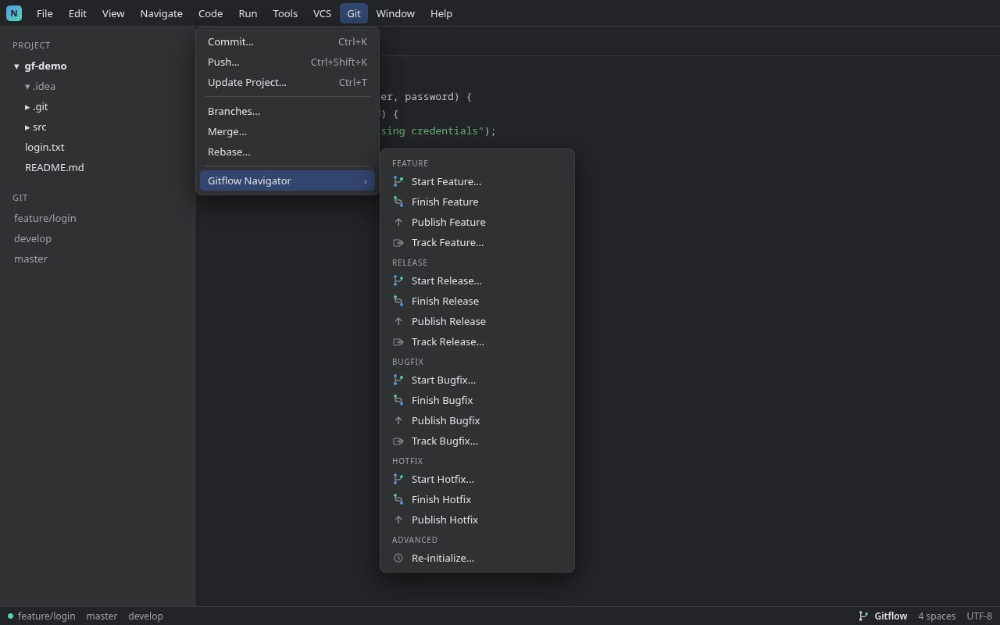
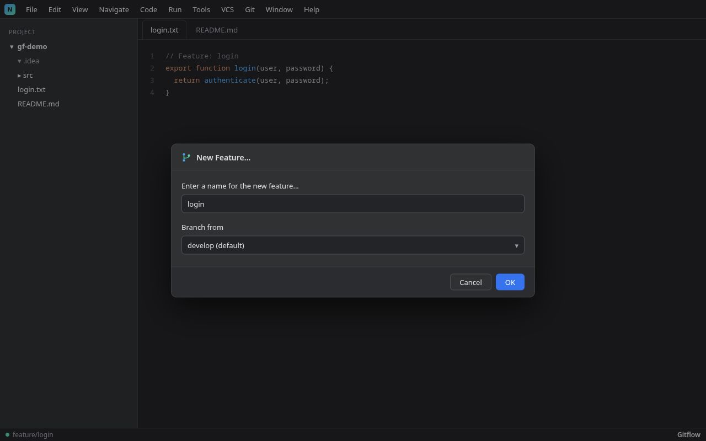
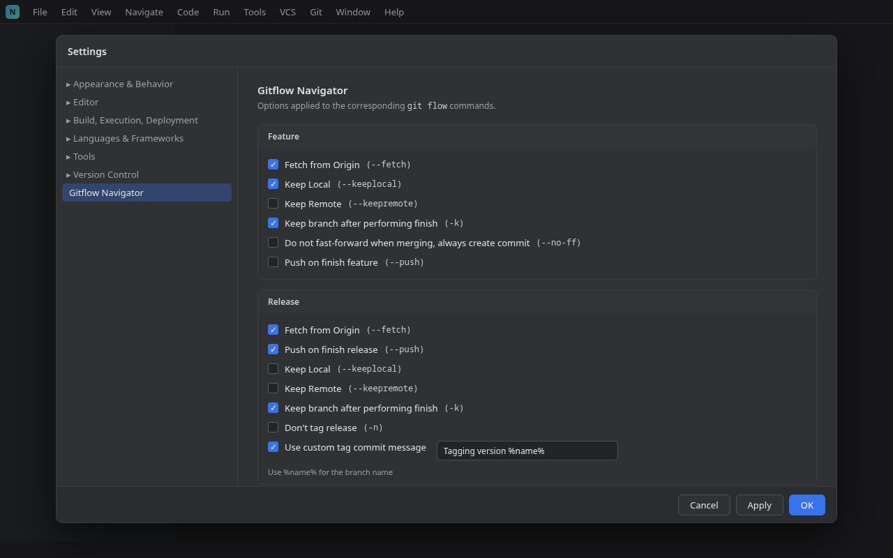

# Gitflow Navigator for JetBrains IDEs

A Git Flow UI for IntelliJ IDEA, WebStorm and PyCharm. It provides a UI layer for the
[git-flow](https://github.com/nvie/gitflow) CLI and covers the feature, release, hotfix
and bugfix branch types.

> **Gitflow Navigator** is a maintained fork of the abandoned
> [Git Flow Integration](https://github.com/OpherV/gitflow4idea) by Opher Vishnia.
> It is **not** affiliated with or endorsed by the original author.
> See [NOTICE](NOTICE) for the full attribution.

Works with both CLI implementations:

- [git-flow AVH](https://github.com/petervanderdoes/gitflow-avh) — legacy, unmaintained;
- [git-flow-next](https://github.com/gittower/git-flow-next) — modern Go implementation.

## Installation

- **JetBrains Marketplace:** search for "Gitflow Navigator".
- **From disk:** download the release ZIP and use
  *Settings → Plugins → ⚙ → Install Plugin from Disk…*
- **Custom plugin repository:**
  *Settings → Plugins → ⚙ → Manage Plugin Repositories…* →
  `https://github.com/borisovcode/gitflow-navigator/releases/latest/download/updatePlugins.xml`

A `git flow` CLI (`git-flow` or `git-flow-next`) must be available on `PATH`.

## Screenshots

## Getting started

For the best introduction to `git flow`, read Jeff Kreeftmeijer's blog post:
[http://jeffkreeftmeijer.com/2010/why-arent-you-using-git-flow/](http://jeffkreeftmeijer.com/2010/why-arent-you-using-git-flow/)

Or have a look at this cheat sheet by Daniel Kummer:
[http://danielkummer.github.io/git-flow-cheatsheet/](http://danielkummer.github.io/git-flow-cheatsheet/)

## Why a fork

The original Git Flow Integration has not been updated since 2021 and its pull requests
have not been merged for years, so it no longer works with current IntelliJ-based IDEs.
Gitflow Navigator keeps the familiar UI while modernising the build and adding support
for current IDE releases and for git-flow-next.

## Credits

- **Opher Vishnia** and all contributors — the original *Git Flow Integration*
  (Apache 2.0), on which this plugin is based.
- **Vincent Driessen** — the git-flow branching model.
- **Peter van der Does** and contributors — git-flow AVH.
- **The Tower team** — git-flow-next.
- **Kirill Likhodedov** — the original git4idea plugin.
- **JetBrains** — the IntelliJ Platform.

## Caveats

The plugin covers init/feature/release/hotfix/bugfix and relies on the installed
`git flow` CLI. Behaviour may differ slightly between git-flow AVH and git-flow-next.

## Contributing

Issues and pull requests are welcome at
[https://github.com/borisovcode/gitflow-navigator](https://github.com/borisovcode/gitflow-navigator).

## License

Apache License 2.0 — see [LICENSE.txt](LICENSE.txt) and [NOTICE](NOTICE).

Copyright 2013-2021 Opher Vishnia and contributors.
Copyright 2026 BorisovCode.
