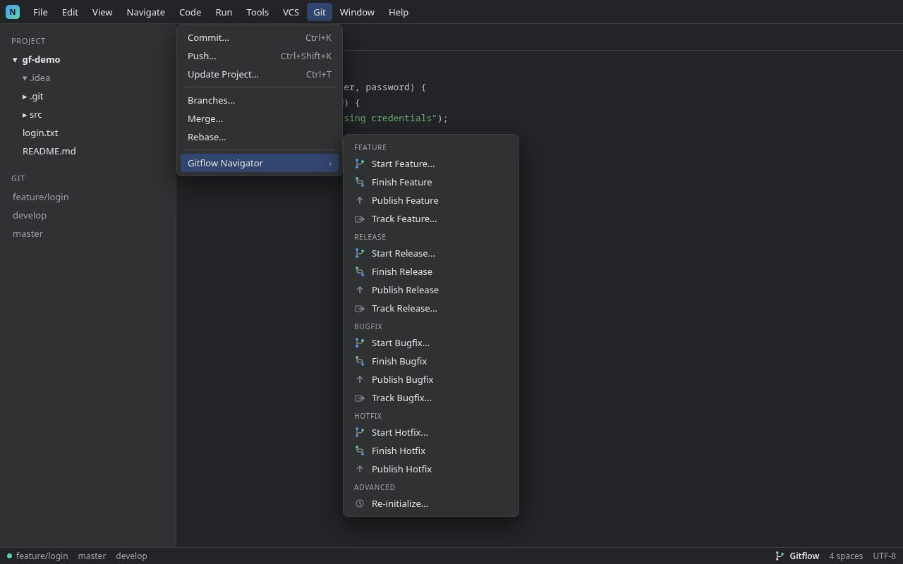
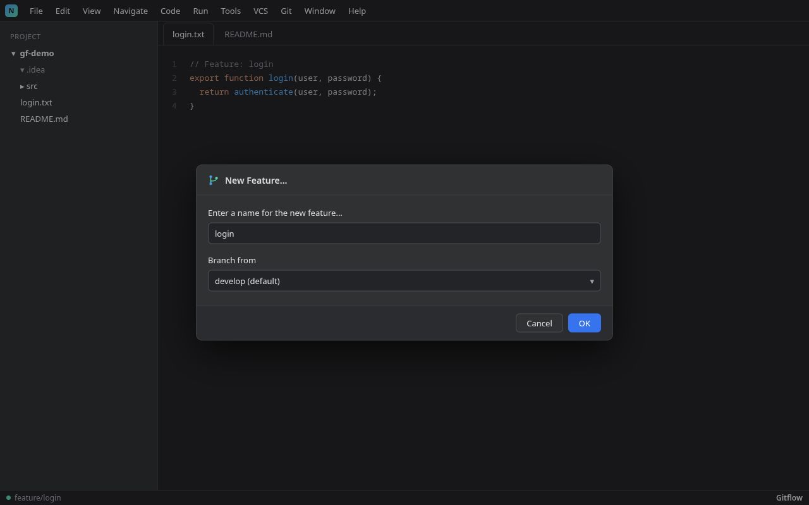
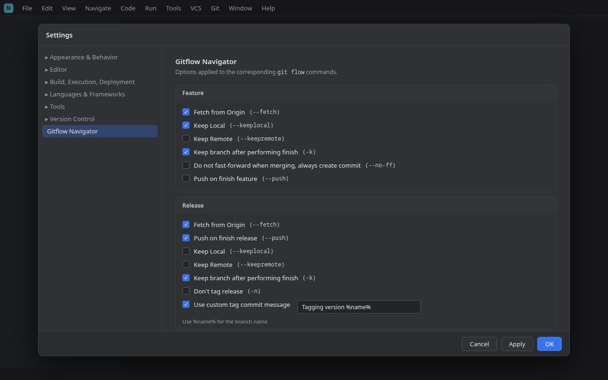

**Gitflow Navigator** — a clean Git Flow UI for JetBrains IDEs. Start, finish,
publish and track feature, release, hotfix and bugfix branches right from the IDE,
on top of the `git flow` CLI you already use.

It is a maintained fork of the abandoned [Git Flow Integration](https://github.com/OpherV/gitflow4idea)
plugin: the familiar workflow, ported to current IntelliJ Platform releases and
extended to support both major git-flow CLI implementations.

## Features

- **All four branch types** — feature, release, hotfix and bugfix: start, finish,
  publish and track, from *Git → Gitflow Navigator* or the status bar widget.
- **Status bar widget** shows whether the current repository is git-flow enabled
  and gives one-click access to every operation.
- **Options per branch type** — fetch from origin on start, push on finish, keep
  local/remote branches, keep the branch after finishing, no-ff merges, custom
  tag messages, "don't tag" releases and hotfixes.
- **Task integration** — start and finish a git-flow branch together with an IDE task.
- **Two CLI implementations supported:**
  - [git-flow AVH](https://github.com/petervanderdoes/gitflow-avh) (the classic one);
  - [git-flow-next](https://github.com/gittower/git-flow-next) (the modern Go implementation).
- **Automatic detection** — the plugin reads the CLI edition from `git flow version`
  and understands both the AVH configuration keys and the git-flow-next
  `gitflow.branch.*` model, so existing repositories work without re-initialisation.
- **Correct per-CLI flags** — the options dialog shows the canonical `--fetch` and
  `--push` flags and translates them to `-F` / `-p` where a CLI requires it.
- **Non-interactive initialisation** — “Initialize Gitflow Repository” passes the
  branch names as flags, so it works with both CLIs in the IDE console.

## Supported IDEs

- IntelliJ IDEA 2026.2 / 2026.3
- WebStorm 2026.2 / 2026.3
- PyCharm 2026.2 / 2026.3
- Any other IntelliJ Platform 2026.2+ IDE that bundles **Git4Idea** and the
  **Tasks** plugin.

No upper build bound: `since-build=262`, updates for future platform versions are
released as they appear.

## Requirements

- IntelliJ Platform **2026.2** or newer.
- A `git flow` command available on `PATH`:
  - **git-flow AVH** 1.12.x, or
  - **git-flow-next** 2.x.
- Built-in **Git4Idea** and **Tasks** plugins (enabled by default in JetBrains IDEs).

## Getting started

1. Open a Git repository in your IDE.
2. If git-flow is not initialised yet, choose **Git → Gitflow Navigator → Initialize
   Gitflow Repository…** and confirm the `master` / `develop` branch names.
3. Use the **Gitflow Navigator** menu or the **Gitflow** status bar widget to start
   and finish features, releases, hotfixes and bugfixes.

## Why a fork?

The original *Git Flow Integration* plugin is no longer maintained and does not
run on recent IntelliJ Platform releases. Gitflow Navigator keeps the UI developers
already know, fixes the platform incompatibilities, and adds support for
git-flow-next — so you do not have to give up the Git Flow workflow when you
upgrade your IDE.

> If the original *Git Flow Integration* plugin is installed, uninstall it to avoid
> duplicate menu entries.

## Credits

- **Opher Vishnia** and contributors — the original *Git Flow Integration*
  (Apache License 2.0), on which this plugin is based.
- **Vincent Driessen** — the Git Flow branching model.
- **Peter van der Does** and contributors — git-flow AVH.
- **The Tower team** — git-flow-next.
- **JetBrains** — the IntelliJ Platform.

Gitflow Navigator is an independent project. It is not affiliated with or endorsed
by the original author, by JetBrains, or by the git-flow-next maintainers.

## License

Apache License 2.0. Source code: https://github.com/borisovcode/gitflow-navigator
